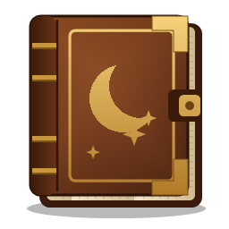
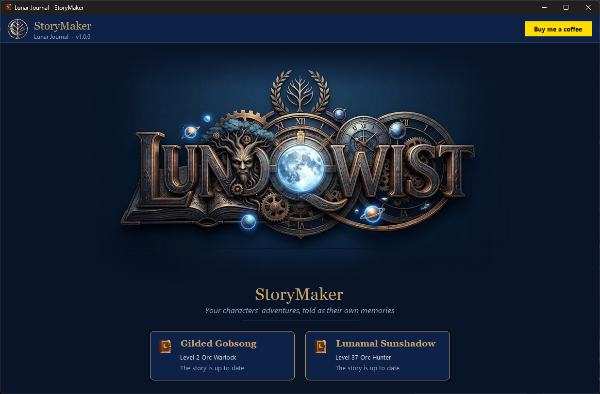
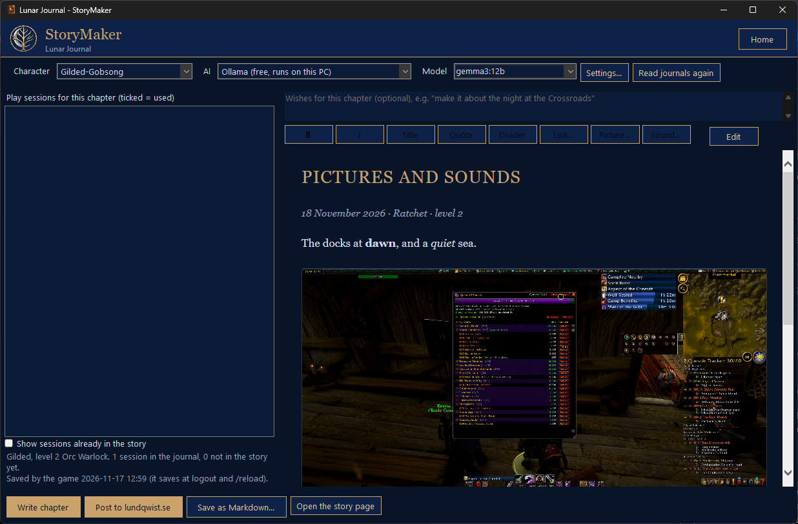

<p align="center">
  
</p>

<h1 align="center">StoryMaker</h1>

<p align="center">
  Turns your World of Warcraft: Forever adventures into your characters' own memories, chapter by chapter.
</p>

<p align="center">
  <a href="https://github.com/Lundqwist/StoryMaker/releases/latest"></a>
  <a href="LICENSE"></a>
  <a href="https://buymeacoffee.com/lundqwist"></a>
</p>

---

While you play, the [Lunar Journal](https://github.com/Lundqwist/LunarJournal) addon writes down what
happens: the quests and who gave them, the people you meet, how long you run, ride and fish, where you
die, and the in-game time of day. StoryMaker hands that journal to an AI of your choosing, which writes a
chapter of your character's life, told by the character, many years later, remembering. You shape
it with pictures from the game and sounds, then post it to your website, or keep it as a Markdown file.

See it live: [Gilded Gobsong's story](https://lundqwist.se/wowcharacters/forever/chapter.html?c=gilded-gobsong&n=1)
on lundqwist.se.





## Install

1. Install the [Lunar Journal](https://github.com/Lundqwist/LunarJournal#installing-the-addon) addon in
   WoW: Forever, and play a little. The game saves the journal when you log out or `/reload`.
2. Download **StoryMaker-&lt;version&gt;-Setup.exe** from the
   [latest release](https://github.com/Lundqwist/StoryMaker/releases/latest) and run it.
   - No admin rights are needed: it installs for your Windows user, in
     `%LOCALAPPDATA%\Programs\StoryMaker`, and adds StoryMaker to the Start menu.
   - .NET is included, so nothing else needs installing. Windows 10 or 11, 64-bit.
   - The installer isn't signed, so Windows may say *"Windows protected your PC"*. Click
     **More info → Run anyway**.
3. Start **StoryMaker** from the Start menu.

To update, run the newer Setup over the old one. To uninstall: **Settings → Apps → StoryMaker**. Your
settings (`%APPDATA%\LunarJournal\StoryMaker.json`) are kept in both cases.

## Choose an AI

Pick one in the **AI** box at the top, and the model next to it.

| AI | Cost | Set up |
|---|---|---|
| **Ollama** (default) | free, runs on your own PC, works offline | Install [Ollama](https://ollama.com) (`winget install Ollama.Ollama`) and a model: `ollama pull gemma3:12b` (about 8 GB; best with a 12 GB graphics card). About a minute per chapter. |
| **Claude** (Anthropic) | paid per use | An API key from [console.anthropic.com](https://console.anthropic.com), then `setx ANTHROPIC_API_KEY "sk-ant-..."`. Writes the best stories. |
| **OpenAI** | paid per use | `setx OPENAI_API_KEY "..."` |
| **Gemini** (Google) | has a free tier | A key from [Google AI Studio](https://aistudio.google.com), then `setx GEMINI_API_KEY "..."` |
| **OpenAI-compatible** | depends | LM Studio, OpenRouter and others: set the address in **Settings** |

Keys are never stored by StoryMaker. It reads them from Windows user environment variables, and
**Settings** shows which it found. Start StoryMaker again after `setx`. A key that clearly isn't the
AI's (for example your website's token) is refused before anything is sent.

## Write a chapter

1. On the front page, click your character. The play sessions not yet in the story are ticked.
2. Optionally write **wishes** for the chapter ("make it about the night at the Crossroads").
3. **Write chapter.** StoryMaker reads the story so far, so the new chapter carries on from the last.
4. Edit the chapter. It's [Markdown](https://commonmark.org/help/), and the bar above it helps:
   - **B**, **I**, **Title**, **Quote**, **Divider** (gold stars between scenes), **Link...**
   - **Picture...** shows the game's screenshots folder as thumbnails, newest first. Pick one and give it
     a caption.
   - **Sound...** adds a sound (mp3, ogg, wav, m4a) with a caption; it becomes a player.
   - **Preview** shows the chapter as it will look on the website.
5. **Post** it to your website, where it becomes the story's next chapter with its own page. Pictures
   (made at most 1600 pixels wide) and sounds are uploaded with it.
   Or **Save as Markdown...**: it's saved as `Documents\Lunar Journal\<Character>\002 <title>.md`, with
   its pictures and sounds in a `media` folder next to it.

**Settings** also has the look (*Dark (lundqwist.se)* navy and gold, or light), the WoW folder, and
the website.

## Posting to a website

StoryMaker posts to [WowCharacters](https://github.com/Lundqwist/WowCharacters), which runs
[lundqwist.se/wowcharacters](https://lundqwist.se/wowcharacters/). To use it for your own characters, set
it up (see its README), put a long random `STORY_TOKEN` in its `.env` and the same value on your PC
(`setx STORY_TOKEN "..."`), and set the site's address in StoryMaker's **Settings**. A character's name
on the site is its journal folder's name in lower case: `Gilded-Gobsong` → `gilded-gobsong`.

Another site can take the posts too, if it answers these calls (all with
`Authorization: Bearer <STORY_TOKEN>`):

| | |
|---|---|
| `GET {site}/api/forever/story?c=<character>` | `{ "markdown": "..." }`: the whole story so far |
| `POST {site}/api/forever/story?c=<character>` with `{ "markdown": "..." }` | saves the next chapter: `{ "chapter": 3 }` |
| `POST {site}/api/forever/media?c=<character>` with a multipart `file` | stores a picture or sound: `{ "url": "..." }` |

Without a website, save the chapters as Markdown: the saved chapters are then the story so far.

## Privacy

The journal is sent only to the AI you choose; with Ollama it never leaves your PC. Only the
finished chapter, with the pictures and sounds you put in it, goes to your website.

## Building it

Needs the [.NET 8 SDK](https://dotnet.microsoft.com/download/dotnet/8.0).

```powershell
dotnet run                          # run it from the source
.\tools\build-package.ps1           # dist\StoryMaker-<version>-Setup.exe (needs Inno Setup 6: winget install JRSoftware.InnoSetup)
```

The version is `<Version>` in `StoryMaker.csproj`.

| File | |
|---|---|
| `Journal.cs` | reads WoW's saved-variables files (Lua tables) and makes the journal the AI gets |
| `StoryPrompt.cs` | what every AI is told, so the stories keep one voice |
| `Writers.cs` | the AIs: Claude through [Anthropic's official C# SDK](https://github.com/anthropics/anthropic-sdk-csharp), OpenAI, Gemini, Ollama's own API |
| `Media.cs` | pictures and sounds: preview, upload, copying next to saved chapters |
| `SiteClient.cs` | the website's story API |
| `MainForm.cs`, `Home.cs`, `Pickers.cs`, `SettingsForm.cs` | the windows |
| `Theme.cs` | the look: lundqwist.se's navy and gold, or light |
| `installer\StoryMaker.iss` | the Inno Setup script |
| `tools\make-icon.ps1`, `tools\make-wizard-images.ps1` | draw the book icon and the installer's pictures |

The Lundqwist emblem and logo in `Assets\` are from [lundqwist.se](https://lundqwist.se).

## License

[MIT](LICENSE) © 2026 Bjarne Lundqwist. World of Warcraft is a trademark of Blizzard Entertainment;
this is a fan project.

If StoryMaker gives your characters a story worth reading, you can
[buy me a coffee](https://buymeacoffee.com/lundqwist).
